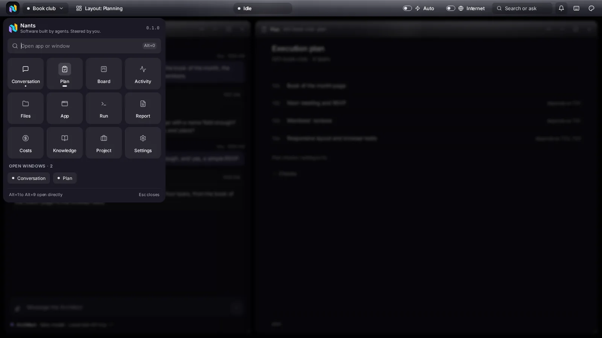
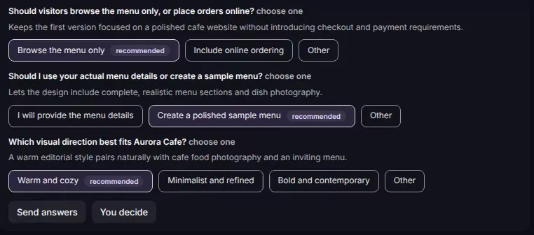

<p align="center">
  
</p>

<h1 align="center">Nants</h1>

<p align="center"><strong>Software built by agents. Steered by you.</strong></p>

<p align="center">You describe the idea. The agents handle the engineering.</p>

<p align="center">
  <a href="LICENSE"></a>
  <a href="https://github.com/tm-dev-lab/nants/releases"></a>
  <a href="https://github.com/tm-dev-lab/nants/actions/workflows/ci.yml"></a>
</p>

<p align="center">
  <a href="https://nants.tmdevlab.com">Website</a> &middot;
  <a href="#install">Install</a> &middot;
  <a href="https://github.com/tm-dev-lab/nants/issues/new/choose">Report an issue</a>
</p>

<p align="center">
  
</p>

## What is Nants

Building software with AI agents still means babysitting prompts, reviewing every change by hand
and hoping the result runs. Nants turns that into an engineering process: an Architect agent turns
your idea into a specification, a Developer builds it task by task and a Reviewer checks every
change against the acceptance criteria. It all runs on your computer, in your own Git repository,
and you decide at every step.

## How it works

1. **Describe** what you want to build in the Conversation.
2. **The Architect asks and plans.** It asks the questions that matter and writes a specification
   with tasks, acceptance criteria and the test command.
3. **You approve.** Nothing is written until you approve the plan.
4. **The Developer builds and the Reviewer checks.** Each task is built in an isolated worktree,
   tested and reviewed; only approved work reaches your project.
5. **Run the app.** The Architect writes a final report and Nants runs the result so you can try it.

<p align="center">
  
</p>

## Features

- **Agents with roles.** Architect, Developer and Reviewer work from a specification with
  acceptance criteria, and every task runs in an isolated Git worktree.
- **Docker for every project.** Tests, checks and the running app live in containers, with
  nothing installed on your system and no `sudo`.
- **Browser testing.** The generated app is opened in a real browser, with screenshots that you
  and the Reviewer can see.
- **Cost per task.** Token usage and an estimated cost in dollars for each spec, task and agent.
- **English and Portuguese.** The whole interface in both languages; the agents follow your choice.
- **Your provider.** Any OpenAI compatible provider, or your ChatGPT plan, with one model per role.
- **No telemetry.** Your keys and your code stay on your computer.

## Requirements

- Linux, or Windows with WSL2 (x86_64 or aarch64)
- [Docker](https://docs.docker.com/engine/install/) with Compose v2, usable without `sudo`
- Git
- An API key for an OpenAI compatible provider, or a ChatGPT Plus or Pro plan

## Install

```sh
curl -fsSL https://nants.tmdevlab.com/install.sh | sh
```

The installer verifies the SHA-256 of the package and installs the executable to
`~/.local/bin/nants`, without `sudo`. You can also download the packages from the
[Releases](https://github.com/tm-dev-lab/nants/releases) page. Then:

```sh
nants                     # start Nants and open it in your browser
nants doctor              # check Docker, Compose, Git, the port and disk space
nants --lan               # also accept access from your local network, for this run only
                          # (to keep it on: Settings > Network access)
nants --help              # all commands and options
```

- **Update:** run the install command again. `nants doctor` tells you when a new version is out.
- **Uninstall:** `nants uninstall` removes the executable; `nants uninstall --purge` also removes
  the settings and data. Your projects in `~/NantsProjects` are never deleted.

### Verify a download

Each release is built from this repository by GitHub Actions, with a SHA-256 file and a build
provenance attestation for every package:

```sh
sha256sum -c nants-X.Y.Z-x86_64-linux.tar.gz.sha256
gh attestation verify nants-X.Y.Z-x86_64-linux.tar.gz --repo tm-dev-lab/nants
```

## Quick start

1. Run `nants`. The **Getting started** guide checks your computer and asks for your provider and
   the model for each agent.
2. Create a project: just give it a name. Nants creates a Git repository in `~/NantsProjects`.
3. Describe your idea in the Conversation, answer the Architect and approve the plan.

## Use your ChatGPT plan

With a ChatGPT Plus or Pro subscription, a connection can use the plan on your account instead of
an API key. This feature is in preview.

1. In **Settings**, click **New connection** and pick **ChatGPT plan (Plus or Pro)**. The same
   choice is in **Getting started**.
2. Click **Continue with ChatGPT** and sign in. The sign-in happens in the browser of the computer
   running Nants, because OpenAI returns to `127.0.0.1`. On a phone or another device, the screen
   asks you to do this step on that computer.
3. Back in Settings, the connection is ready, named after your account e-mail, with the models of
   your account. Pick them under **Agents**.

Usage counts against your plan, with no cost in dollars; the Costs window shows it as
**ChatGPT plan**, in tokens. On Plus, the 5-hour usage limit is shared with your other apps that
use the plan. Check it with **Manage usage** (<https://chatgpt.com/settings/usage>). When the limit
is reached, the run pauses until you click **Continue**.

The sign-in is stored in the Nants data folder (`~/.local/share/nants`), in files readable only by
your user. **Sign out**, on the connection row, revokes the access at OpenAI and deletes the
sign-in from this computer. If Nants asks you to sign in again, use **Reconnect**.

## Use it from your phone (local network)

By default, Nants opens only on your computer. To open it from your phone or another device on
the same network, go to **Settings > Network access**. The page guides you in steps and checks
each one before enabling the next:

- **WSL (NAT, the default):**
  1. Turn on **Local network access** and restart Nants (Ctrl+C, then `nants`).
  2. Run the **Script to enable it on Windows** once, in PowerShell as administrator. It forwards
     the ports to WSL and creates the Nants firewall rule, for any network type and only for the
     local subnet. The WSL IP changes when Windows restarts; the step goes back to pending and you
     run the script again.
  3. Add your devices.
- **WSL (mirrored):** the same steps; the script only creates the Windows firewall rule.
- **Linux:** turn it on, restart and add your devices. If you use a firewall, allow the Nants
  port and the preview ports.

**This computer.** In network mode, the terminal prints a sign-in link for this computer and
opens it in the browser. It works once and for 10 minutes. On a real loopback connection, no link
is needed.

**Add a device.** Click **Add device**. Nants shows a 6-digit code that changes every 60 seconds,
the address to open and a QR code of that address. On the other device, open the address or scan
the QR code and type the code. The code only works while that window is open, up to 10 minutes;
after 5 wrong attempts, generate another one.

**Authorized devices.** The list shows each device with when it joined and its last access. You
can rename or revoke it; revoking cuts its open sessions right away. **Revoke all** is there too.
If you revoke this computer, sign in again with the terminal link.

To turn it off, switch it off on the same page and, on WSL, run the **Script to undo it on
Windows**. The device list is kept. `nants --lan` turns it on for a single run, without saving.

Only devices you add can open Nants. This holds for any address outside loopback, including
`--host` with `--allow-remote`. The preview ports (3001 to 3010) serve the generated app, not
Nants, and do not ask for a device. On the local network, traffic is plain HTTP, not encrypted: for
the most security, use it on a network you trust. See [SECURITY.md](SECURITY.md).

## Troubleshooting

**The page does not open in the Windows browser.** An old Windows port redirect, set up for
network access, takes the Nants port. Nants detects it, starts on the next free port and
explains it in the terminal. To undo it, run the **Script to undo it on Windows** from
**Settings > Network access**, or turn local network access on if you want to keep it.
`nants doctor` shows your environment and whether Windows matches the saved option.

**The sign-in link expired.** The link works once and for 10 minutes. Restart Nants for a new
one, or add this browser as a device with a code from a device that is already authorized.

**It does not open on the other device?** Common causes:

- the device is on another network or on a guest network;
- the router isolates devices from each other;
- step 2 is still pending (on WSL, the IP may have changed after a Windows restart);
- the address was typed wrong; prefer the QR code.

If the sign-in page opens on the device, the network is fine.

## Build from source

You need Rust stable. The web interface is already built in `web/dist` and embedded into the
executable, so Node is only needed to change the interface (Node 24).

```sh
cargo build --release            # executable in target/release/nants
```

Run the tests through `scripts/test.sh`, which gives each run its own temporary folder and removes
it at the end:

```sh
scripts/test.sh cargo test
(cd web && npm ci && ../scripts/test.sh npx vitest run)
```

After changing `web/`, rebuild the interface with `(cd web && npm run build)` and then the
executable. See [ARCHITECTURE.md](ARCHITECTURE.md) for how the code is organized.

## Privacy

- **No telemetry.** Nants sends nothing to us. It talks to the providers you configure, to
  `nants.tmdevlab.com` to check for a new version and, for cost estimates, downloads a public
  price catalog.
- **Your keys stay local.** API keys are stored only in your configuration file and are never
  shown in full, logged or sent to the browser. The ChatGPT plan sign-in stays in the data folder,
  readable only by your user, and is never logged or sent to the browser.
- The server listens only on your computer (`127.0.0.1`) by default.

To report a vulnerability, see [SECURITY.md](SECURITY.md).

## Contributing

Nants is developed through an internal process that we are still consolidating. For now, we
welcome issues (bug reports and suggestions), but we don't accept pull requests. This repository
is a published mirror of the product; changes are made upstream and published here with each
release. See [CONTRIBUTING.md](CONTRIBUTING.md) for how to open a good issue.

## License

Licensed under the [Apache License 2.0](LICENSE). See [NOTICE](NOTICE).

---

Nants by [TM Dev Lab](https://www.tmdevlab.com) · [nants.tmdevlab.com](https://nants.tmdevlab.com)
